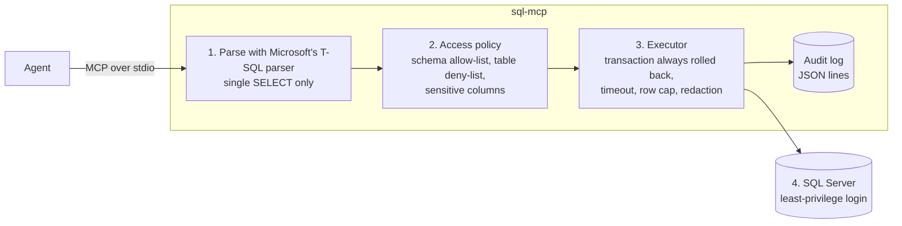

# sql-mcp

[](https://github.com/kthakur17/sql-mcp/actions/workflows/ci.yml)


A [Model Context Protocol](https://modelcontextprotocol.io) server that lets AI agents (Claude Code, Claude Desktop, any MCP client) explore and query a SQL Server database **without being able to change it, read what they shouldn't, or take the server down**.

Handing an agent a connection string is the quick way to let it answer questions about your data, and the quick way to discover that "clean up the test rows" means `DELETE`. sql-mcp sits in between: the agent gets schema discovery, read-only queries and query plans; everything else is refused with a reason the agent can act on, and every call is audited.

## Tools

| Tool | What it does |
|---|---|
| `server_info` | Connected database, login, version, query limits, and warnings if the login can write |
| `list_tables` | Tables and views the agent may query, with approximate row counts and `MS_Description` text |
| `describe_table` | Columns, types, defaults, primary key, indexes, and foreign keys in both directions |
| `run_query` | One read-only `SELECT` (CTEs allowed), capped rows, sensitive columns redacted |
| `explain_query` | Estimated plan **without running the query**: cost, costliest operators, large scans, missing-index suggestions |

All five are annotated `readOnlyHint: true`, so clients can run them without a confirmation prompt.

## Defence in depth

No single check is trusted to be perfect. A query has to get through every layer:



1. **Parse, don't pattern-match.** Queries are parsed with [ScriptDom](https://www.nuget.org/packages/Microsoft.SqlServer.TransactSql.ScriptDom), the parser SQL Server's own tooling uses. Comments, string literals, `GO` separators and odd whitespace can't hide a second statement, because the check runs on the syntax tree, not the text. Rejected: anything but one `SELECT`, `SELECT ... INTO`, `OPENROWSET`/`OPENQUERY`/`OPENDATASOURCE`, linked-server and (by default) cross-database names, `NEXT VALUE FOR`, temp tables, and locking hints that block other sessions. → [ADR 0001](docs/adr/0001-parse-tsql-instead-of-pattern-matching.md)
2. **Policy.** An optional schema allow-list and a glob deny-list (`audit.*`, `dbo.Users`) apply everywhere a table can appear: joins, subqueries, CTE bodies, table-valued functions. Denied tables are missing from `list_tables`, foreign keys that point at them are dropped from `describe_table`, and asking for one returns the same "not found" as a table that doesn't exist.
3. **Execution.** Every query runs inside a transaction that is always rolled back, with a command timeout and a row cap. When the cap is hit the server-side query is cancelled rather than drained. → [ADR 0002](docs/adr/0002-always-rolled-back-transaction.md)
4. **Sensitive columns.** Columns matching `*password*`, `*token*`, `*secret*`, `ssn` and similar (plus your own patterns) are **blocked** when named explicitly, which closes `WHERE PasswordHash LIKE 'a%'` probing, and **redacted** when they arrive through `SELECT *`. → [ADR 0003](docs/adr/0003-block-named-sensitive-columns-redact-starred-ones.md)
5. **The database is the real boundary.** On startup sql-mcp checks the login's own permissions and warns on stderr if it can write. [`scripts/create-readonly-user.sql`](scripts/create-readonly-user.sql) creates a login that can't.

The limits of this model are written down in [docs/SECURITY.md](docs/SECURITY.md).

## What an agent sees

Real output from the demo database ([`scripts/demo-database.sql`](scripts/demo-database.sql)), with `MaxRows` set to 5:

```jsonc
// run_query: SELECT * FROM dbo.Customers
{
  "columns": [{"name":"Id","type":"int"}, {"name":"Name","type":"nvarchar"}, {"name":"Email","type":"nvarchar"},
              {"name":"City","type":"nvarchar"}, {"name":"PasswordHash","type":"varbinary"}, {"name":"CreatedAt","type":"datetime2"}],
  "rows": [[1,"Customer 1","customer1@example.com","Pune","[REDACTED]","2026-10-28T04:11:56.0000000"], "..."],
  "rowCount": 5,
  "truncated": true,
  "redactedColumns": ["PasswordHash"],
  "note": "Only the first 5 rows were returned. Narrow the query with WHERE, TOP or aggregation rather than raising the limit."
}
```

```text
run_query: SELECT Email FROM dbo.Customers; DELETE FROM dbo.Orders
→ Query rejected:
  - Exactly one statement is allowed; found 2.

run_query: SELECT Email FROM dbo.Customers WHERE PasswordHash IS NOT NULL
→ Query rejected:
  - Column 'PasswordHash' is marked sensitive and cannot be referenced. Remove it from the query.
```

## Quick start

Requires the [.NET 10 SDK](https://dotnet.microsoft.com/download) and a SQL Server you can reach (LocalDB, Express, Azure SQL, or a container).

```bash
git clone https://github.com/kthakur17/sql-mcp && cd sql-mcp
dotnet pack src/SqlMcp -c Release -o ./artifacts
dotnet tool install --global SqlMcp.Server --add-source ./artifacts
```

Optional demo database:

```bash
sqlcmd -S "(localdb)\MSSQLLocalDB" -Q "CREATE DATABASE SqlMcpDemo"
sqlcmd -S "(localdb)\MSSQLLocalDB" -d SqlMcpDemo -i scripts/demo-database.sql
```

**Claude Code**

```bash
claude mcp add sql -- sql-mcp "--SqlMcp:ConnectionString=Server=(localdb)\MSSQLLocalDB;Database=SqlMcpDemo;Integrated Security=true;TrustServerCertificate=true"
```

**Claude Desktop** (`claude_desktop_config.json`)

```json
{
  "mcpServers": {
    "sql": {
      "command": "sql-mcp",
      "args": ["--config", "C:\\path\\to\\sql-mcp.json"]
    }
  }
}
```

Then ask something like *"Which city brings in the most revenue from orders that weren't cancelled? Check the plan before running anything heavy."*

## Configuration

Settings live under the `SqlMcp` section and can come from a JSON file (`--config path`), environment variables (`SqlMcp__MaxRows=500`) or arguments (`--SqlMcp:MaxRows=500`), with later sources winning.

```json
{
  "SqlMcp": {
    "ConnectionString": "Server=myserver;Database=Shop;User Id=sql_mcp_reader;Password=...;Encrypt=true",
    "MaxRows": 200,
    "CommandTimeoutSeconds": 30,
    "MaxCellLength": 1000,
    "AllowedSchemas": ["dbo", "sales"],
    "DeniedTables": ["dbo.Users", "audit.*"],
    "SensitiveColumns": ["DateOfBirth", "*Iban*"],
    "AllowCrossDatabase": false,
    "AuditLogPath": "C:\\logs\\sql-mcp-audit.jsonl"
  }
}
```

| Setting | Default | Notes |
|---|---|---|
| `ConnectionString` | (required) | Use a least-privilege login |
| `MaxRows` | 200 | Ceiling per query; an agent can ask for fewer, never more |
| `CommandTimeoutSeconds` | 30 | Applies to queries and plans |
| `MaxCellLength` | 1000 | Long text is cut, with the remaining length noted |
| `AllowedSchemas` | (all) | When set, unqualified table names are rejected, since their schema can't be known for sure |
| `DeniedTables` | (none) | Globs over `schema.table` |
| `SensitiveColumns` | (none) | Added to the built-in patterns, never replacing them |
| `AllowCrossDatabase` | false | Linked-server names stay blocked either way |
| `AuditLogPath` | `%LOCALAPPDATA%/sql-mcp/audit.jsonl` | One JSON line per call: allowed, rejected or failed |

## Development

```bash
dotnet build
dotnet test
```

The suite has three layers:

- **Unit tests** cover the validator against a catalogue of allowed and malicious queries, plus the access policy and the plan summariser.
- **Integration tests** run against a throwaway database. LocalDB is used by default, or any server named by `SQLMCP_TEST_SERVER`. They are skipped when no server is reachable locally, and they fail in CI.
- **End-to-end tests** start the real server process and drive it over stdio with the official MCP client.

CI runs all three on Ubuntu against SQL Server 2022 in a service container, then packs the .NET tool.

```text
src/SqlMcp
  Safety/      QueryValidator (ScriptDom), AccessPolicy
  Data/        QueryExecutor, SchemaCatalog, PlanExplainer
  Auditing/    AuditLog
  Tools/       the MCP tool surface
tests/SqlMcp.Tests
  Safety/ Data/   unit tests
  Integration/    database and end-to-end MCP tests
docs/          security model and architecture decision records
```

## Roadmap

- Streamable HTTP transport with authentication, for a shared server rather than one per developer
- Optional cost gate: refuse a `run_query` whose estimated plan cost exceeds a threshold
- PostgreSQL support behind the same tool surface

## License

[MIT](LICENSE)
